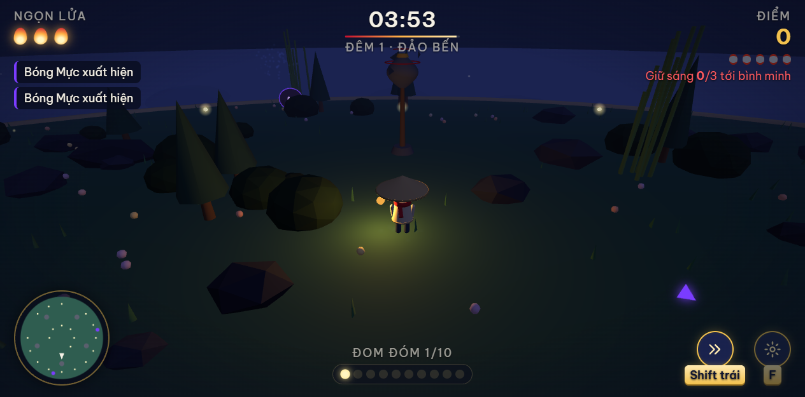

# Đảo Đèn Lồng — v1.0.1

> **Video demo:** *(đính kèm GitHub Release v1.0.0 / `docs/demo/demo.mp4`)* · **Chơi online:** bản Cloudflare tự cập nhật từ nhánh `main` (link trong mô tả repo)



Game 3D góc nhìn thứ ba chạy trên trình duyệt. Bạn điều khiển **Mây**, người giữ đèn nhỏ tuổi đội nón lá, quàng khăn đỏ. Qua **ba đêm** (Đảo Bến, Đảo Cau, Đảo Chuông), Mây gom đom đóm để thắp và **giữ sáng** các Đèn Lồng Lớn tới bình minh, né **Bóng Mực** (chúng hút dầu đèn) và **Gió Lạc** trong sương đen.

- Engine: Three.js r160 (đóng gói sẵn trong `vendor/`). Toàn bộ luật chơi viết bằng JavaScript thuần trong `src/sim/`, dùng chung cho bản web, headless, soak và bench.
- Test Contract **v1.3**: [game.contract.json](game.contract.json).

## Yêu cầu hệ thống

| | Tối thiểu |
|---|---|
| Hệ điều hành | macOS, Linux hoặc Windows |
| Node.js | ≥ 18 để chơi, test, chạy headless và soak; **≥ 22** cho `bench` và các script dùng trình duyệt (cần WebSocket có sẵn) |
| Trình duyệt | Chrome, Edge hoặc Chromium mới (WebGL2). Firefox và Safari chơi được nhưng `bench` chỉ hỗ trợ trình duyệt họ Chromium |
| Phần cứng | GPU tích hợp trở lên; khoảng 1 GB RAM trống cho trình duyệt |

Không có thư viện npm nào phải tải về.

## Cài đặt và chạy (3 lệnh)

```bash
git clone <repo> && cd <repo>
npm install            # không có dependency, chỉ kiểm tra môi trường
npm start              # mở http://localhost:8080
```

Bản web tĩnh (GitHub Release v1.0.0 hoặc `npm run build:web` → `dist/`) chạy được trên mọi web server tĩnh. Khi đó bảng xếp hạng lưu trong bộ nhớ trình duyệt thay vì file.

## Điều khiển (đổi được trong Cài đặt)

| Mặc định | Hành động |
|---|---|
| W A S D | Di chuyển theo hướng camera |
| Chuột (khóa con trỏ khi chơi) / ← → | Xoay camera |
| Space | Nhảy |
| Shift | Lướt |
| E | Nạp đèn / thắp lại / châm dầu |
| F | Tỏa Sáng (tốn 3 đom đóm) |
| Esc | Tạm dừng |

## Luật chơi và điểm

- **Giữ đảo sáng tới bình minh** (240 / 270 / 300 giây). Lúc hết giờ phải còn sống và có ≥ 60% số đèn đang sáng (3/5, 4/6, 5/7).
- Thắp đèn lần đầu tốn 10 đom đóm; thắp lại đèn đã tắt tốn 5. Đèn sáng hao dầu 1/giây; châm dầu +10 mỗi đom đóm.
- Đèn có dầu ≥ 30 có vùng an toàn 6 m. Dầu < 30 thì Bóng Mực tới hút dầu (5/giây).
- Sức chứa đom đóm bằng 10 + 2 × số lần thắp thành công (tối đa 20).
- Thua khi hết 3 Ngọn Lửa, hoặc tới bình minh mà không đủ số đèn sáng.

| Sự kiện | Điểm |
|---|---|
| Mỗi đom đóm nạp vào đèn | +5 |
| Thắp lần đầu / thắp lại | +100 / +40 |
| Bóng Mực trúng Tỏa Sáng | +5 (+15 nếu nó đang hút dầu) |
| Bình minh (khi thắng): mỗi đèn sáng | +50 + phần nguyên dầu còn lại |
| Bình minh (khi thắng): mỗi Ngọn Lửa | +50 |

Tổng điểm của hành trình là tổng điểm các đêm đã thắng.

## Cài đặt và tiếp cận (accessibility)

- Âm lượng, độ nhạy chuột, giới hạn FPS (30/60/120/144/không giới hạn), hiện FPS, độ phân giải 50–100%.
- **Đổi phím** cho mọi hành động. Phím trùng được tô đỏ kèm cảnh báo; có nút **Khôi phục mặc định**.
- **Phụ đề và chỉ báo hình ảnh:** Bóng Mực xuất hiện (kèm mũi tên ở mép màn hình chỉ về phía nó), gió sắp thổi, 10 giây cuối, đèn sắp hết dầu.
- **Giảm chuyển động:** tắt rung camera và chớp màn hình. **Chữ lớn** ×1.25. Mọi chữ giao diện ≥ 18 px ở 1280×720.
- **Bảng màu dễ phân biệt:** Bóng Mực #00B3FF, cảnh báo trắng kèm ⚠; đèn tắt bị xẹp và rách giấy.
- Tất cả được lưu trên trình duyệt. Game hỗ trợ mọi tỷ lệ màn hình.

## Bảng xếp hạng

Sau màn Bình Minh, hoặc sau khi thua ở bất kỳ đêm nào, người chơi nhập tên (3–12 ký tự chữ, số hoặc `_`; tiếng Việt có dấu cũng được) để lưu điểm. Bảng giữ top 10, sắp theo điểm giảm dần; bằng điểm thì ai đạt trước đứng trên. Xem từ menu chính, nút **Bảng xếp hạng**.

- Khi chạy `npm start`, điểm lưu vào `data/leaderboard.json` trên máy và vẫn còn sau khi tắt game.
- Xuất bảng xếp hạng: `node scripts/serve.mjs --export-leaderboard out.json` (`run_cmd` trong contract) → `{"entries": [...]}`.
- **Dùng máy bạn làm server cho nhiều người:** `npm start` in ra các địa chỉ LAN (ví dụ `http://192.168.1.x:8080`). Máy khác cùng Wi-Fi mở địa chỉ đó là chơi được và dùng chung bảng xếp hạng; nếu không vào được, cho phép Node.js qua tường lửa. Muốn mời người ngoài Internet: `cloudflared tunnel --url http://localhost:8080` (Cloudflare Quick Tunnel, miễn phí) sẽ tạo một link `https://….trycloudflare.com`.
- Bản tĩnh trên Cloudflare không có server nên mỗi trình duyệt có bảng riêng.

## Chế độ Mod

Gõ `787898` khi đang chơi, hoặc nhập vào ô "Mã bí mật" trong menu tạm dừng: mọi đèn sáng và luôn đầy dầu, Mây bất tử (Bóng Mực không gây sát thương, rơi khỏi đảo thì về điểm xuất phát mà không mất gì). Mod giữ nguyên tới hết lượt chơi, và **lượt có Mod không được lưu vào bảng xếp hạng**. Luật Mod nằm trong `Sim.setCheats()`, mặc định tắt; headless, soak và bench không bao giờ bật nó (`tests/mod.test.mjs`).

## Kiểm chứng

```bash
npm test                                                   # 66 test headless (contract v1.0–v1.3, dầu đèn, bảng xếp hạng, soak, bench stats)
node src/headless.mjs --seed 1 --night 1 --ticks 3600 --out out.jsonl [--scenario s.json] [--inputs i.json]
node --expose-gc --max-semi-space-size=1 src/soak.mjs --seed 7 --nights 10 --out soak.json   # soak_cmd
node scripts/bench.mjs --seed 42 --duration 30 --out bench.json                              # bench_cmd
```

- **Bench** mở cửa sổ Chrome/Edge 1280×720 (không toàn màn hình) với `--disable-gpu-vsync --disable-frame-rate-limit`, chạy cảnh benchmark chuẩn (`?bench`), khởi động 3 giây rồi đo đúng `--duration` giây.
  - `load_ms` tính từ lúc tiến trình bench bắt đầu tới khung hình đầu tiên của cảnh.
  - `peak_mem_mb` là tổng RSS của mọi tiến trình trình duyệt của lần chạy, lấy mẫu mỗi giây.
  - Trong cảnh bench, phần sáng tạo thêm bị tắt: cây, nhà, đá, hoa, đom đóm trang trí, hạt hiệu ứng.
- **Soak** chạy 10 đêm trong một tiến trình. Cờ `--max-semi-space-size=1` giữ vùng nhớ cho đối tượng mới tạo của V8 nhỏ. `heapUsed` không tăng qua 60 đêm, nghĩa là không rò rỉ (xem [phase-4.md](docs/notes/phase-4.md)).
- Kết quả trên máy dev: [bench.json](bench.json) (avg 99 FPS, p1-low 56, load 0,9 s) · [soak.json](soak.json) (0 crash, RSS ×1,13).
- Bằng chứng từng phase: [docs/proof/](docs/proof/phase-4/README.md). CI chạy `npm test` trên Node 18/22 sau mỗi lần push.

## Tài liệu

[CHANGELOG.md](CHANGELOG.md) · [ADR 0001](docs/adr/0001-lantern-fuel-and-dawn-win.md) · ghi chép từng phase: [1](docs/notes/phase-1.md) [2](docs/notes/phase-2.md) [3](docs/notes/phase-3.md) [4](docs/notes/phase-4.md) · [Retro](docs/notes/retro.md) · [CREDITS.md](CREDITS.md) · [LICENSE](LICENSE) · đề lab: [docs/lab/](docs/lab/README.md)

## Harness AI

[AGENTS.md](AGENTS.md) (được [CLAUDE.md](CLAUDE.md) nạp vào), skill [.claude/skills/verify-phase](.claude/skills/verify-phase/SKILL.md), Stop hook trong [.claude/settings.json](.claude/settings.json) chặn agent kết thúc khi `npm test` đỏ, và các script kiểm chứng `scripts/proof.mjs`, `scripts/browser-proof.mjs`.

## Sáng tạo của tôi

Mọi phần thêm đều nằm trong `src/client/` (chỉ phần hiển thị). Chúng không đổi đầu ra headless (42 → 66 test và các phép kiểm tra tất định vẫn đạt) và bị tắt trong cảnh bench.

- **Menu sống động:** video `video/menu.mp4` quay cảnh bay qua ba hòn đảo (tạo bằng `scripts/record-menu-video.mjs`), nhạc nền `maintheme.mp3`. Nếu không có video, bot tự chơi phía sau menu.
- **Đảo sinh động:** nhà sàn có cửa sổ sáng, bến gỗ có thuyền mây, tre, đá, bụi cây, cỏ, hoa (vẽ bằng instancing).
- **Ông Đăng** kể chuyện mỗi đêm; màn Bình Minh có tiếng chuông.
- Minimap, hệ hạt hiệu ứng, bầu trời sao, Mây có dáng đi và khăn bay, âm thanh tạo bằng Web Audio.
